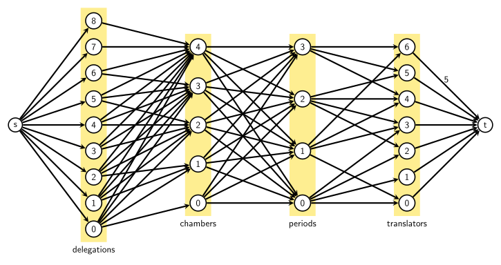
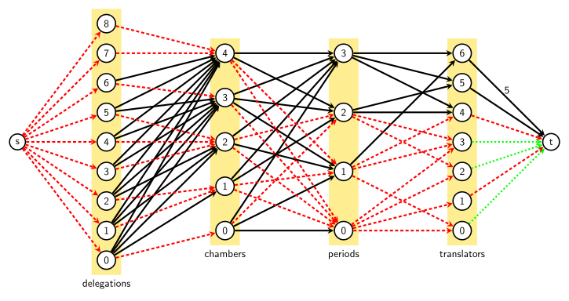

<figure style="float:right;width:40%;margin-left:20px">
<a href="graph-before.svg"></a>
<figcaption style="text-align:center">The constructed graph to run max flow on.  The delegations and chambers are sorted by size, with the smaller delegations and chambers on the bottom.</figcaption>
</figure>

Earth has been selected to host the first Intergalactic Diplomatic Summit, bringing together delegations from dozens of alien civilizations. Each delegation has a different number of representatives and requires a conference chamber large enough to accommodate them.

The summit has several meeting periods, and each delegation must be accompanied by a certified interspecies translator. Unfortunately, translators are available during only certain periods, and galactic labor regulations limit how many delegations each translator can assist.

Determine the maximum number of diplomatic meetings that can be scheduled and construct a schedule assigning each delegation a conference chamber, meeting period, and translator.

**Part 1: Reduce to Max Flow:** You will be given the number of alien delegations ($d$), a number of conference chambers ($c$), a number of meeting periods ($p$), and a number of translators ($t$).  For the sake of this assignment, these entities are all 0-index integers -- so if $d=7$, then the alien delegations are just 0 through 6.  To solve this problem, you will have to construct a graph such as the upper image on the right.  In that image, there are five sets of bipartite "ranges".  With the exception of one of those sets, all edges have capacity set to 1.

1. From the start ($s$) to each of the delegations: this represents that there is only one meeting needed per delegation. If a delegation had multiple meetings, then the capacity would be set higher, but that is not part of this assignment.
2. From the delegations to the chambers: any delegation can fit into any chamber that has a sufficient capacity.  Thus, the lines in this section only connect to chambers that can hold the number of diplomats in the delegation.  In the diagram, both the delegations and the chambers are sorted by size with the smaller delegations / chambers on the bottom.  The delegation sizes will be provided in the input.
3. From the chambers to the meeting periods: any meeting could potentially be at any period, so this is a complete sub-graph (every chamber connects to every period).
4. From the meeting periods to the translators: this is based on the translator's availability, which is provided in the input.
5. From the translators to the terminus ($t$): to allow the max flow to complete.  Each translator has some limit of meetings they can cover, so the capacity on these edges is set to that limit -- 5, in this example, but the actual limit varies by the input case.

Once max flow is run on this updated graph, you might get something like the lower of the images to the right.  In that image, the red dashed edges have flow 1, and the green dotted edges allow more flow (translator 3 to the terminus has capacity 3, the other two green edges -- from translators 0 and 2 -- have capacity 2).  This graph was the result of an actual solution for this assignment, the input of which is given below.

<figure style="float:right;width:40%;margin-left:20px">
<a href="graph-after.svg"></a>
<figcaption style="text-align:center">The result of running max flow on the graph.  The delegations and chambers are sorted by size, with the smaller delegations and chambers on the bottom.</figcaption>
</figure>

You will need to print the max flow value (as an integer) from this part in your final output.  The max flow of the graph shown is 9.

**Part 2: Extract the schedule:**  Once we have run max flow, we need to extract a valid schedule from the graph.  This can be done by tracing the paths through the graph, following edges with flow -- you can pick any outbound path from a given node.  Thus, there may be multiple valid schedules for a given input.


### Input

The first line of the input will contain $n$, the number of test cases in that file.  Each test case will use a different graph.

The first line of each test case will contain five positive integers: $d$, $c$, $p$, $t$, and $t_c$, space separated.  The first four values are the number of delegations, chambers, periods, and translators, respectively.  The last value is the translator capacity -- how many meetings they can handle.  For the examples shown in the images, $(d,c,p,t,t_c)=(9,5,4,7,5)$.  However, these values -- including $t_c$ -- will vary on the input used to test your program.

The next line will contain $d$ positive integers, which is the delegation sizes of the $d$ delegations.  These will be sorted in non-descending order.

The next line will contain $c$ positive integers, which is the chamber capacity of the $c$ chambers.  These will be sorted in non-descending order.

The next $t$ lines will contain the scheduling information for the $t$ translators.  Each of these lines will start with a positive integer $x$ which is how many periods that translator is available for, followed by the $x$ periods the translator is available for (space separated).

All values, both input and output, will fit in a 32-bit singed integer.  All of the attributes referenced (delegations, chambers, periods, and translators) are represented as consecutive integers indexed from 0.

You may assume that the provided graph is valid.  You may not assume that the max flow will be equal to the number of delegations.  In some test cases, there will be delegations that cannot have any meetings scheduled.

All input is to be read from standard input.

### Output

The first line of the output per test case will be the (integer) max flow of the graph.  This will fit into a 32-bit signed integer.

If you were unable to complete part 2 (extracting the schedule), then you should print out a -1 on a second line for each test case.

If you were able to complete part 2, then the next $d$ lines will contain their path (aka their schedule.)  It will be of the form `1 - 2 - 3 - 0`, which indicates that delegation 1 will use chamber 2 at period 3 with translator 0.  These lines can print out in any order.  Note that the separator between each is three characters: space, dash, space.  You may also print out a single letter prefix before each, such as `d1 - c2 - p3 - t0` to indicate delegation, chamber, period, and translator; either format is acceptable, but the ONLY letters you can use on those lines are 'd', 'c', 'p', and 't' (upper case or lower case).

If a delegation is not assigned a chamber / period / translator, then print the delegation number and -1: `4 -1` or `d4 -1`.

There are likely going to be many max flow paths through the graph, and any correct one -- meaning a valid flow of maximum value -- is acceptable.

All output is to be written to standard output.

### Sample input

This input corresponds to the first graph shown above.  In that image, the delegations and chambers are sorted by size, with the smaller delegations and chambers shown on the bottom of their respective column.  This means that delegation $d_0$, the smallest delegation, is at the bottom of the delegations column, and likewise with the chamber column.  The number in each node in the image corresponds to its index number in the input.  

This file is available as [pa5-example.in](files/pa5-example.in):

```
1
9 5 4 7 5
12 20 34 57 63 63 87 153 725
18 48 72 100 850
2 0 1
1 0
2 0 2
3 0 1 2
3 1 2 3
2 2 3
2 1 3
```


### Sample output

This output corresponds to the second graph shown above.  This file is available as [pa5-example.out](files/pa5-example.out):

```
9
d8 - c4 - p1 - t4
d7 - c4 - p0 - t3
d6 - c3 - p0 - t2
d5 - c2 - p2 - t3
d4 - c2 - p1 - t3
d3 - c2 - p0 - t1
d2 - c1 - p1 - t0
d1 - c1 - p0 - t0
d0 - c0 - p2 - t2
```

Note that you could have eliminated the letters ('d', 'c', 'p', and 't') in the above output.  In this example there were multiple correct answers, and this is just one of them.  Any correct answer is acceptable.

### Requirements

You are *required* to reduce this problem to a max-flow problem.  You should use the networkx package for Python or the JGraphT package for Java.

- Networkx: [https://networkx.org/](https://networkx.org/)
- JGraphT: [https://jgrapht.org/](https://jgrapht.org/)

Your final submission should be in a file named `pa5.py` or `PA5.java`.

### Execution

We will run your program as follows:

```
cat pa5-example.in | python3 pa5.py
```

or:

```
cat pa5-example.in | java PA5
```

This takes the output of what is on the left (`cat pa5-example.in`, whose output is the contents of the [pa5-example.in](files/pa5-example.in) file) and uses it as the input to what is on the right.  This version should work in all platforms (Windows, MacOS, and Linux).

### Submission

You will submit your completed `pa5.py` or `PA5.java` file to Gradescope.  There will be a *small set* of acceptance tests that are *NOT COMPREHENSIVE*.  These acceptance tests are the test cases in [pa5-example.in](files/pa5-example.in) file.  It's up to you to comprehensively test your code.  The acceptance tests just verify that you are reading the input correctly and providing the expected output.

